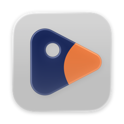
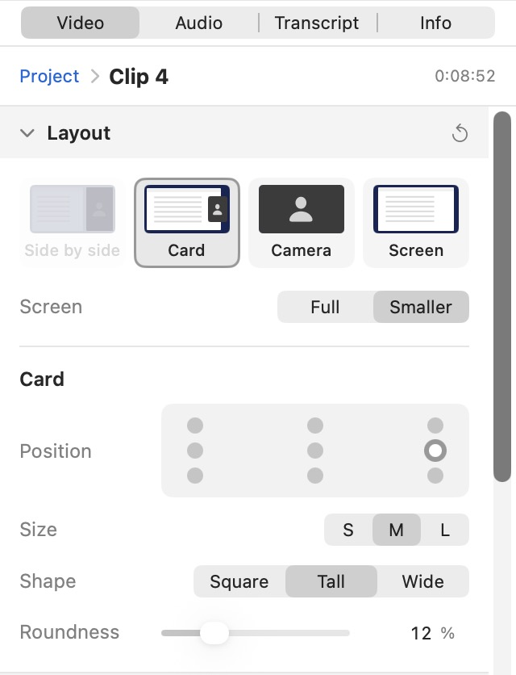
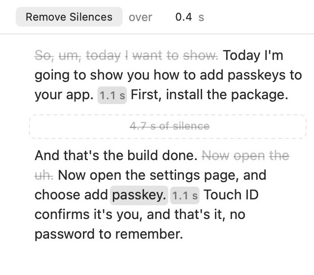
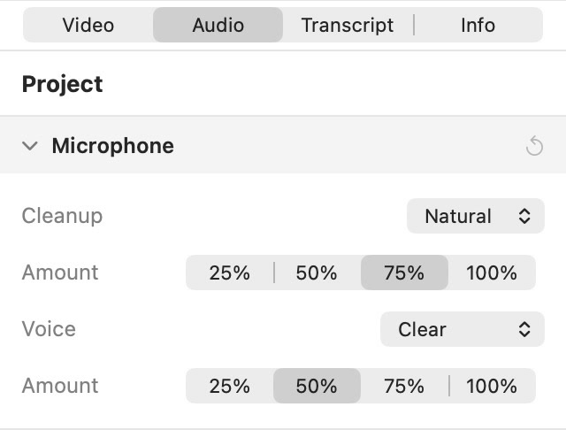
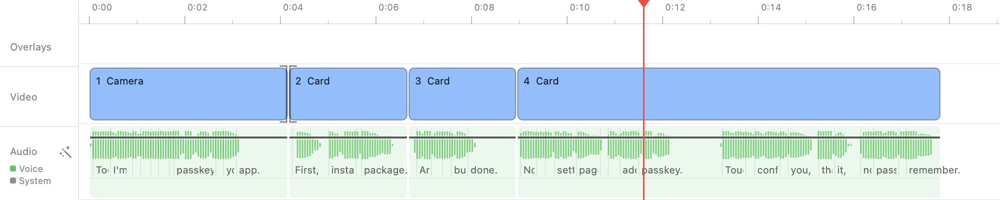

<p align="center">
  
</p>

<h1 align="center">CueCan for Mac</h1>

<p align="center">
  A free screen recorder and editor for macOS.
</p>

<p align="center">
  <a href="https://cuecan.com"><b>Download</b></a>
  ·
  <a href="https://github.com/cuecan/screen-recorder/releases">Releases</a>
</p>

<p align="center">
  <a href="LICENSE"></a>
  
  
</p>

<p align="center">
  
</p>

## Record

- Record your screen with your camera, or the camera alone.
- Choose 16:9, 9:16 or both before you record. CueCan captures the part of the screen that fits, and snaps windows into it.
- The screen, the camera, the microphone and the Mac's own sound are each saved as a separate file.
- Measure the delay between your camera and your microphone once, and every take is lined up.

## Edit

After a take, CueCan cleans up your voice and transcribes it, timing every word.

- Cut words and pauses in the transcript, and fix a word it misheard.
- Trim, split and speed up clips on the timeline, or hold the screen on one frame while you keep talking.
- Lay out each clip: side by side, the camera as a card over the screen, the camera alone or the screen alone.
- Move, resize and reshape the card, and zoom the camera.
- Set the background, the space around the screen and the corners for the whole video.
- Choose how much to clean up the microphone and how the voice sounds.
- Add captions to the video.
- Undo any change. The recordings themselves are never altered.

<table>
  <tr>
    <td valign="top" width="33%"><br><sub>The layout of a clip, and its camera card.</sub></td>
    <td valign="top" width="33%"><br><sub>The transcript, with cut words and pauses struck out.</sub></td>
    <td valign="top" width="33%"><br><sub>Cleanup and Voice, each with an amount.</sub></td>
  </tr>
</table>

<p align="center">
  
</p>

## Export

- A finished video as MP4, at 1080p or 4K, with the sound levelled for YouTube.
- The 16:9 video and the 9:16 Short, both from one take.
- Captions as SRT, and the transcript as text.
- A timeline for Final Cut Pro or DaVinci Resolve, to finish the edit there.

## Edit with an agent

CueCan has a local [MCP](https://modelcontextprotocol.io) server, so an agent such as Claude can edit the take you have open. You can ask it, for example, to "keep the last take of each line and cut the pauses." The server is optional, and the app does everything above without it.

```sh
claude mcp add cuecan-mac -- /Applications/CueCan.app/Contents/Helpers/cuecan mcp
```

## Build

```sh
git clone https://github.com/cuecan/screen-recorder.git
cd screen-recorder
open CueCan.xcodeproj        # Xcode 27; set your own signing team, then Run
```

```sh
cd Packages/CueCanKit && swift test
```

Most of the code is the Swift package in `Packages/CueCanKit`, and the Xcode project is the SwiftUI app around it. [`docs/architecture.md`](docs/architecture.md) has the modules, and `AGENTS.md` tells a coding agent how the repository works.

## License

[GPL-3.0](LICENSE). What CueCan builds on is listed in [THIRD-PARTY-NOTICES.md](THIRD-PARTY-NOTICES.md).

The CueCan name and icon aren't covered by that license: a changed version needs its own.
