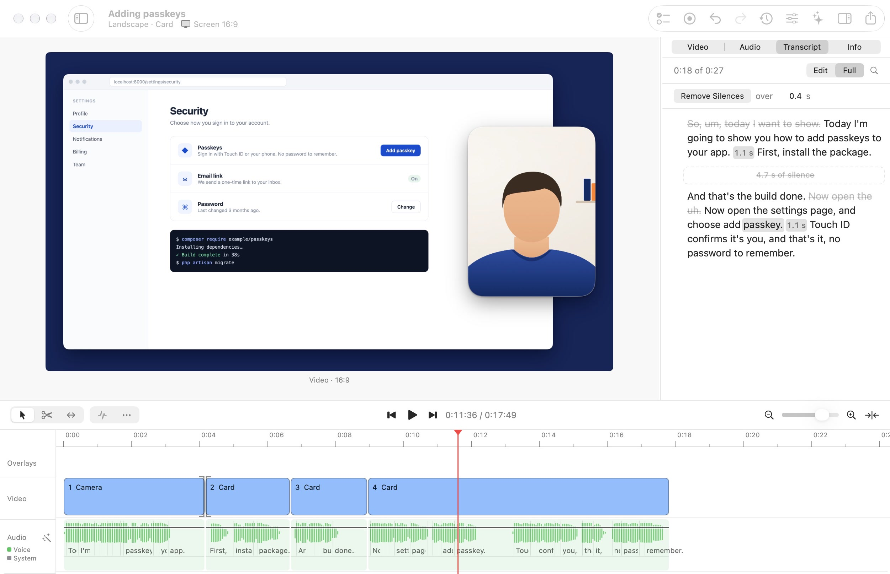

<p align="center">
  
</p>

<h1 align="center">CueCan for Mac</h1>

<p align="center">
  A free screen recorder and editor for macOS.<br>
  Record your screen and camera. Edit. Export. Everything runs on your Mac.
</p>

<p align="center">
  <a href="https://cuecan.com"><b>Download</b></a>
  ·
  <a href="https://cuecan.com">Website</a>
  ·
  <a href="https://github.com/cuecan/screen-recorder/releases">Releases</a>
  ·
  <a href="https://cuecan.com/mac/privacy">Privacy</a>
</p>

<p align="center">
  <a href="LICENSE"></a>
  
  
</p>

<p align="center">
  
</p>

Every download is built from a tag in this repository by GitHub Actions, and is on the [Releases](https://github.com/cuecan/screen-recorder/releases) page with its checksum.

---

## What it does

- **Records** your screen with your camera, or the camera alone, as separate tracks.
- **Shapes the video for where it's going:** 16:9, 9:16, or both from one take.
- **Cleans your voice** after recording, without touching the original.
- **Transcribes on your Mac** and times every word.
- **Edits by transcript or timeline:** cut words, tighten pauses, trim, blade, speed up, hold a frame.
- **Exports** MP4, captions as SRT, and a timeline for Final Cut or Resolve.

<table>
  <tr>
    <td valign="top" width="33%"><br><sub>Lay out each clip: side by side, a card, the camera or the screen.</sub></td>
    <td valign="top" width="33%"><br><sub>Read the take as text. Cut words and pauses where you see them.</sub></td>
    <td valign="top" width="33%"><br><sub>Clean up the microphone and choose how much.</sub></td>
  </tr>
</table>

<p align="center">
  
</p>

## And one thing more

CueCan has a local [MCP](https://modelcontextprotocol.io) server, so Claude can edit the same take you're looking at: "keep the last take of each line and cut the pauses." It's optional. The app does everything above without it.

```sh
claude mcp add cuecan-mac -- /Applications/CueCan.app/Contents/Helpers/cuecan mcp
```

## Private by design

- No account.
- Recordings are ordinary files in `~/Movies/CueCan`.
- The app makes three kinds of request, and you can watch for them: a check for updates and a line of news from cuecan.com, about once a day, and a one-time download of the speech models from Hugging Face.

[What the app sends, in full →](https://cuecan.com/mac/privacy)

## Requirements

- macOS 26 or later
- A Mac with Apple silicon

## Beta

This is a beta. Each build records for 90 days, then asks you to update; what you've recorded always opens and exports. Updates are free.

## Build it yourself

```sh
git clone https://github.com/cuecan/screen-recorder.git
cd screen-recorder
open CueCan.xcodeproj        # Xcode 27; set your own signing team, then Run
```

```sh
cd Packages/CueCanKit && swift test
```

Most of the app is the Swift package in `Packages/CueCanKit`; the Xcode project is the thin SwiftUI app around it.

How the modules fit together is in [`docs/architecture.md`](docs/architecture.md).

Working with a coding agent? `AGENTS.md` and the skills in `.agents/skills/` tell it how this repository works.

## Check a download

Each release is built, signed and notarized by [a workflow in this repository](.github/workflows/release.yml), from the tagged commit. To check that a DMG is the one that workflow made:

```sh
gh attestation verify CueCan-<version>.dmg -R cuecan/screen-recorder
```

## License

[GPL-3.0](LICENSE). What CueCan builds on is listed in [THIRD-PARTY-NOTICES.md](THIRD-PARTY-NOTICES.md).

The CueCan name and icon aren't covered by that license: a changed version needs its own.

